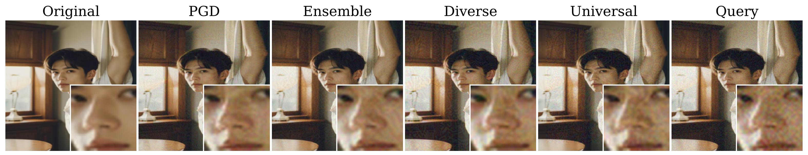

# Adversarial Robustness of AI-Generated Image Detectors in the Real World

Sina Mavali, Jonas Ricker, David Pape, Asja Fischer, and Lea Schoenherr. DIMVA 2026.

[Paper: arXiv:2410.01574](https://arxiv.org/abs/2410.01574)



## Setup

Install [uv](https://docs.astral.sh/uv/) and sync the environment:

```bash
uv sync
```

The lockfile uses PyTorch CUDA 13 wheels on Linux x86_64. Change the `torch` and `torchvision` source in `pyproject.toml` if your machine needs a different PyTorch build.

## Data and Checkpoints

`data/` is local-only and ignored by git.

Download the prepared artifacts from Google Drive: [ADV-DF artifacts](https://drive.google.com/open?id=1QLxoSEcF4Rmw02l4Xm89IKCOzKVspw-6).

Create local artifact directories:

```bash
mkdir -p data/dataset data/checkpoints data/results data/attack_results
```

Copy downloaded checkpoint files into `data/checkpoints/`. Extract downloaded dataset archives into `data/dataset/`.

Put datasets under `data/dataset/<name>/`:

```text
data/dataset/synthbuster_500/
  fake/<generator>/*.png
  real/<source>/*.png
```

The reproduction scripts expect:

```text
data/dataset/synthbuster_500
data/dataset/chameleon_500
data/dataset/gpt4o_500
```

Put detector checkpoints under `data/checkpoints/`:

| Detector | Checkpoint file |
| --- | --- |
| `ojha_sd14` | `ojha-sd14.pth` |
| `ojha_sd14_r2` | `ojha-sd14-robust-eps2.pth` |
| `ojha_sd14_r4` | `ojha-sd14-robust-eps4.pth` |
| `corvi_sd14` | `corvi-sd14.pth` |
| `drct_clip_sd14` | `drct-sd14-clip-vit-l14.pth` |
| `drct_convb_sd14` | `drct-sd14-convnext-base.pth` |

Use `--checkpoint-dir PATH` for another checkpoint directory, or `--checkpoint DETECTOR=PATH` to override one detector.

The Drive folder includes `SHA256SUMS.txt`. After download, verify files from the downloaded artifact root with:

```bash
sha256sum -c SHA256SUMS.txt
```

## Run

Normal evaluation:

```bash
./scripts/eval.sh --checkpoint-dir data/checkpoints
```

Real-world/degraded evaluation applies JPEG compression, resize, blur, and noise before detector preprocessing:

```bash
./scripts/eval.sh --preprocessing --checkpoint-dir data/checkpoints
```

Adversarial evaluation:

```bash
for eps in 4 8 16; do
  ./scripts/attack.sh --eps "$eps" --checkpoint-dir data/checkpoints
done
```

Small adversarial example run:

```bash
./scripts/adv_examples.sh --detector ojha_sd14 --dataset synthbuster_500 --attack pgd --eps 4 --samples 8 --checkpoint-dir data/checkpoints
```

Outputs are written under `data/results/` and `data/attack_results/`.

## Training

```bash
./scripts/train.sh --detector ojha --data data/dataset/genimage/train
./scripts/train.sh --detector corvi --data data/dataset/genimage/train
```

DRCT is evaluated from author checkpoints.

## External Code

Vendored detector code and licenses are kept under `src/external/`:

- UnivFD / Ojha et al., CVPR 2023
- DRCT / Chen et al., ICML 2024
- Corvi et al., ICASSP 2023

## Citation

```bibtex
@inproceedings{mavali2026advdf,
  title = {Adversarial Robustness of AI-Generated Image Detectors in the Real World},
  author = {Mavali, Sina and Ricker, Jonas and Pape, David and Fischer, Asja and Sch{\"o}nherr, Lea},
  booktitle = {Proceedings of the 23rd International Conference on Detection of Intrusions and Malware, and Vulnerability Assessment (DIMVA 2026)},
  year = {2026},
  note = {Accepted. arXiv:2410.01574},
  url = {https://arxiv.org/abs/2410.01574},
}
```
